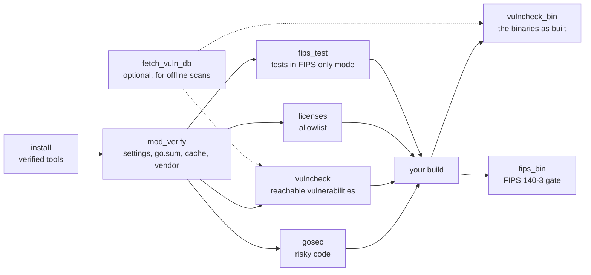

<div align="center">


# Go Security for CircleCI and GitHub Actions

### Check Go code, and the binaries you ship, for security on every commit: reachable vulnerabilities, risky code, licenses, module integrity and FIPS 140-3.

Install checksum-verified [govulncheck](https://go.dev/doc/security/vuln/), [gosec](https://github.com/securego/gosec), [go-licenses](https://github.com/google/go-licenses) and [Go](https://go.dev/dl/), and gate builds on what they find, as orb commands or GitHub Actions.<br>
Vulnerabilities in code you actually call · Binaries checked as built · An offline vulnerability database · FIPS 140-3 evidence for auditors<br>
SARIF, OpenVEX, JUnit and run records · Findings told apart from tools that didn't run · Strict SHA-512 verification by default · No `sudo`

[](https://circleci.com/gh/juburr/go-security-orb)
[](https://github.com/juburr/go-security-orb/actions/workflows/actions.yml)
[](https://circleci.com/developer/orbs/orb/juburr/go-security-orb)
[](LICENSE)
[](https://discuss.circleci.com/c/ecosystem/orbs)


**[Quick Start](#-quick-start)** · **[Features](#-why-go-security-orb)** · **[Recipes](#-recipes)** · **[Commands](#-commands)** · **[GitHub Actions](#-github-actions)** · **[Reports](#-reports)** · **[Security](#-secure-by-design)** · **[Network Access](#-network-access)**

<sub>An unofficial, community-maintained CircleCI orb and set of GitHub Actions. [Contributions are welcome!](#-contributing)</sub>

</div>

<br>

## ✨ Why go-security-orb?

<table>
<tr>
<td width="33%" valign="top">
🎯 <b>Vulnerabilities you can actually reach</b><br><br>
<code>vulncheck</code> runs govulncheck, which reports a known vulnerability only when your code can call the vulnerable function, so a finding is worth fixing. Imported and merely required ones are reported too, without failing the build, unless you choose a wider <code>scan</code>.
</td>
<td width="33%" valign="top">
📦 <b>The binaries you ship, as built</b><br><br>
Every Go binary records the Go release and module versions that built it. <code>vulncheck_bin</code> scans them with no source and no build, and checks the standard library of the Go that really built each one, which a source scan can't.
</td>
<td width="33%" valign="top">
🏛️ <b>FIPS 140-3, with evidence</b><br><br>
<code>fips_bin</code> fails a binary that doesn't link a validated Go Cryptographic Module, defaults FIPS mode off, or links cryptography from outside the standard library, and writes each binary's SHA-256 and settings to a run record. <code>fips_test</code> finds code that breaks in FIPS mode before production does.
</td>
</tr>
<tr>
<td width="33%" valign="top">
🔌 <b>Offline and air-gapped</b><br><br>
<code>fetch_vuln_db</code> fetches the Go vulnerability database once, from vuln.go.dev or your mirror, checks it is complete and current, and hands it to later jobs, which then scan without network access to vuln.go.dev.
</td>
<td width="33%" valign="top">
🧱 <b>Dependencies exactly as go.sum says</b><br><br>
<code>mod_verify</code> fails on settings that turn checksum verification off, a module cache changed since download, a go.sum that doesn't match, imports go.mod lacks and a stale vendor directory, and pins <code>GOTOOLCHAIN=local</code> so no go.mod can swap in another Go.
</td>
<td width="33%" valign="top">
🧾 <b>Reports reviewers can use</b><br><br>
SARIF for code scanning, OpenVEX for vulnerability status, JUnit for test views, JSON and CSV inventories, and run records that say exactly what was checked, with which tools, database and settings. Accepted findings need a written reason, and stay in the reports.
</td>
</tr>
</table>

### 🧩 The Orb vs. a Hand-Rolled Script

| | `go install golang.org/x/vuln/cmd/govulncheck@latest` and friends | go-security-orb |
| --- | --- | --- |
| Tools | Whatever `@latest` resolves to today, built by each job | Pinned versions, checked against SHA-512 checksums in the orb, and cached |
| A tool that can't run | Often exits 0 with nothing found, or 1 just as for findings | Fails the step whatever `report_only` says, with the tool's own error |
| Fail-open traps | Easy to hit: a database without its index, `GOFLAGS=-mod=mod`, an unreadable standard library version, a stripped binary, a go-licenses that took your code for the standard library | Each one checked for and turned into a failure |
| Standard library vulnerabilities | For the Go in CI, which may not be the one you ship with | `go_version` for source scans, and the real version from each binary with `vulncheck_bin` |
| Exceptions | Comment out the step, or grep the output | `ignore` and `allowed_crypto_modules` with a required reason, `#nosec` justifications enforced on request |
| Evidence | Logs | SARIF, OpenVEX, JUnit and run records with SHA-256s of every input and report |

## 🔄 How It Works



1. `install` installs the tools a job needs, each checked against the orb's checksum table.
2. `mod_verify` checks the module settings and that every dependency is exactly what go.mod and go.sum name, and pins the Go toolchain for the steps after it.
3. `gosec`, `vulncheck` and `licenses` check the source of each module.
4. After your build, `vulncheck_bin` and `fips_bin` check the binaries themselves.

Every check tells findings apart from a tool that didn't complete: findings fail the step unless `report_only` is true, and a tool that couldn't check fails it always, so a broken scan never reads as a clean one.

## 🚀 Quick Start

### CircleCI

```yaml
version: 2.1

orbs:
  go-security: juburr/go-security-orb@0.1.0

jobs:
  security:
    docker:
      - image: cimg/go:1.27
    steps:
      - checkout
      - go-security/install:
          tools: govulncheck gosec go-licenses
      - go-security/mod_verify
      - go-security/gosec
      - go-security/vulncheck
      - go-security/licenses

workflows:
  security:
    jobs:
      - security
```

### GitHub Actions

```yaml
name: Security

on: push

permissions:
  contents: read

jobs:
  security:
    runs-on: ubuntu-24.04
    steps:
      - uses: actions/checkout@v7
      - uses: juburr/go-security-orb/actions/install@v0.1.0
        with:
          tools: go govulncheck gosec go-licenses
      - uses: juburr/go-security-orb/actions/mod_verify@v0.1.0
      - uses: juburr/go-security-orb/actions/gosec@v0.1.0
      - uses: juburr/go-security-orb/actions/vulncheck@v0.1.0
      - uses: juburr/go-security-orb/actions/licenses@v0.1.0
```

Each check writes its reports to `/tmp/go-security-reports` and stores them as artifacts, even when it fails. See [GitHub Actions](#-github-actions) for how the actions map to the orb's commands.

## 🍳 Recipes

### Adopt the Checks Gradually

Every check takes `report_only`: it writes every report and warns, but passes. Turn it on for a check whose findings you aren't ready to fix, and off once they are fixed. A tool that can't complete still fails the step.

```yaml
      - go-security/gosec:
          report_only: true
```

### Accept a Vulnerability, With a Reason

`ignore` takes one vulnerability per line, a `GO-`, `CVE-` or `GHSA-` ID and why it is accepted. An entry without a reason fails the step. Accepted vulnerabilities stay in every report, marked as accepted, and SARIF marks their results suppressed with the reason.

```yaml
      - go-security/vulncheck:
          ignore: |
            GO-2024-2687 the HTTP/2 server is never exposed; only the client is used
            CVE-2023-45288 same as above
```

### Scan the Binaries You Ship

A source scan checks the standard library of the Go in CI. `vulncheck_bin` reads each binary's own Go release and module versions, so run it on what you release:

```yaml
      - run: go build -o dist/server ./cmd/server
      - go-security/vulncheck_bin:
          binaries: dist/*
```

To keep source scans honest too, set `go_version` to the release you build with, such as `go_version: go1.27.3`.

### Scan Without Network Access to vuln.go.dev

Fetch the database in one job, then scan with it in jobs that can't reach vuln.go.dev, or that shouldn't depend on it:

```yaml
jobs:
  fetch-db:
    docker:
      - image: cimg/go:1.27
    steps:
      - go-security/fetch_vuln_db:
          path: /tmp/workspace/vulndb
      - persist_to_workspace:
          root: /tmp/workspace
          paths: [vulndb]
  scan:
    docker:
      - image: cimg/go:1.27
    steps:
      - checkout
      - attach_workspace:
          at: /tmp/workspace
      - go-security/install
      - go-security/vulncheck:
          db: /tmp/workspace/vulndb
```

In the same job, later steps need nothing at all: `fetch_vuln_db` exports `GO_SECURITY_VULN_DB`, which `vulncheck` and `vulncheck_bin` use when `db` is empty. `source` takes an internal mirror of `https://vuln.go.dev/vulndb.zip`, and `sha256` pins a copy you reviewed. The database has no signatures of its own, so `fetch_vuln_db` checks what it can: only the files a copy holds, as plain files, its index complete, every entry the index lists present, and its age.

### Gate FIPS 140-3 Builds

Build with `GOFIPS140`, then let `fips_bin` check what the binaries really are:

```yaml
      - run:
          name: Build
          command: GOFIPS140=v1.0.0 CGO_ENABLED=0 go build -o dist/server ./cmd/server
      - go-security/fips_bin:
          binaries: dist/*
          require_cgo_disabled: true
      - go-security/fips_test
```

`fips_bin` fails a binary built with a Go older than 1.24, without `GOFIPS140`, with `GOFIPS140=latest` (FIPS mode on the in-tree code, which no validation covers), with FIPS mode off by default (a `godebug fips140=off` line in go.mod turns it off), with cgo when `require_cgo_disabled` is true, or linking cryptography modules from outside the standard library, such as `golang.org/x/crypto` or `github.com/cloudflare/circl`, unless `allowed_crypto_modules` accepts them with a reason. Its run record, on by default, lists each binary's SHA-256, Go release and settings.

`fips_test` runs the tests with `GODEBUG=fips140=only`, where MD5, SHA-1 and other algorithms FIPS 140-3 doesn't allow return an error or panic, and lists the algorithms each failing test used. It is report-only by default; set `report_only: false` once the tests pass. A test that panics ends its package's test binary, so the package runs again without it, to find what the later tests use.

> [!NOTE]
> These checks show how a binary was built and how its code behaves in FIPS mode. They are not a FIPS 140-3 validation: that covers the Go Cryptographic Module, which is what `GOFIPS140` links in, and your use of it in its operational environment.

### Use Private Modules

`mod_verify` sets `GOPRIVATE` and writes credentials for your module host to `~/.netrc` (mode 0600), for itself and every later step:

```yaml
      - go-security/mod_verify:
          private_modules: github.com/my-org/*
          private_host: github.com
          # The defaults: environment variables, such as from a context.
          username: PRIVATE_MODULES_USERNAME
          password: PRIVATE_MODULES_TOKEN
```

A `private_modules` pattern that matches public modules, such as `github.com` or `github.com/*`, fails the step: go would fetch every module it matches without checking it against the checksum database.

### Check Every Module

`modules: all` checks every module below `working_dir` (skipping `vendor`, `testdata` and directories whose names start with `.` or `_`), and the reports name each one. Or list the module directories:

```yaml
      - go-security/vulncheck:
          modules: services/api, services/worker
```

### Require Reasons for `#nosec`

gosec honors `#nosec` comments and reports them with their justifications. `require_suppression_reasons` counts one without a justification as a finding, so every suppression in the code says why:

```go
h := md5.Sum(body) // #nosec G401 -- names a cache entry, not a security boundary
```

## 🧰 Commands

Run `install` before the other commands in the same job. cimg/go images, and GitHub's runners with `actions/setup-go` or the `install` action's `go`, already have Go; the checks run whichever `go` comes first on the `PATH`. Every check writes to `output_dir` (default `/tmp/go-security-reports`) and stores it as job artifacts under `go-security-reports/`, even when the step fails. Give each run of a command in a job its own `report_name`.

These parameters mean the same in every check that takes them:

| Parameter | Default | Description |
| --- | --- | --- |
| `working_dir` | `.` | Directory to run in. `modules`, `binaries` and other paths are relative to it. |
| `modules` | `.` | The modules to check, as directories that hold a `go.mod`, separated by commas or spaces, or `all` (see [Check Every Module](#check-every-module)). |
| `packages` | `./...` | The package patterns to check in each module, separated by commas or spaces. A pattern can't start with `-`. |
| `tags` | *(empty)* | Build tags, separated by commas. |
| `extra_args` | *(empty)* | More arguments for the tool, split like shell words: nothing in them is expanded or run. Arguments a command sets itself are refused. |
| `output_dir`, `report_name`, `junit`, `run_record`, `report_only`, `store_artifacts` | | See [Reports](#-reports). |

String parameters expand environment variables (`$NAME`, `${NAME}`) with the CircleCI CLI, except `output_dir`, which is also passed to `store_artifacts`.

### `go-security/install`

Installs the tools named in `tools`, each verified against the orb's checksum table, through that tool's own install command (below), for amd64 or arm64 from `uname -m`.

| Parameter | Default | Description |
| --- | --- | --- |
| `tools` | `govulncheck,gosec` | The tools to install, separated by commas or spaces: `go`, `govulncheck`, `gosec`, `go-licenses`. An unknown name fails the step. `go` installs first, so the rest find it. |
| `go_version`, `govulncheck_version`, `gosec_version`, `go_licenses_version` | `1.27.3`, `1.9.0`, `2.30.0`, `2.0.1` | Each tool's version, used when `tools` names it. |
| `install_path` | `$HOME/bin` | Absolute path of the directory to install govulncheck, gosec and go-licenses into, writable without root. Created if needed, and added to the `PATH` for later steps when it isn't already on it. |
| `go_install_path` | `$HOME/sdk/go` | Absolute path of the Go installation (its `GOROOT`). It must be missing, hold no files, or be a Go installation `install_go` made before, which it replaces. Its `bin` directory is put first on the `PATH`. |
| `verify_checksums` | `strict` | `strict`, `known_versions` or `false`, for every tool. See [Checksum Verification](#-checksum-verification). |
| `caching` | `true` | Cache each tool's verified download (govulncheck's and go-licenses' verified build) between jobs, keyed by tool, version, CPU architecture and home directory. A cached file is verified again before it is used. |
| `download_base_url` | *(empty)* | An `https://` mirror of GitHub releases, for gosec, in place of `https://github.com`, serving the same paths. What it serves is still verified. Credentials (`user:password@`), a query and a fragment are refused, since they would show in the log. |
| `go_download_base_url` | *(empty)* | The same, as a mirror of `https://dl.google.com/go`, for Go's release archive and the Go release that builds govulncheck and go-licenses. |

### `go-security/install_<tool>`

`install_go`, `install_govulncheck`, `install_gosec` and `install_go_licenses` install one tool each, as `install` does, and take `version`, `install_path`, `verify_checksums`, `caching` and `download_base_url` with the same meaning (for `install_go`, `install_govulncheck` and `install_go_licenses`, `download_base_url` is the Go mirror). Use one to install a tool at a version of its own, or in a job that needs only that tool.

- `install_go` installs the whole release into `install_path` (default `$HOME/sdk/go`), which must be missing, hold no files, or be an earlier `install_go` installation, so a mistyped path such as `$HOME` is never replaced.
- `install_govulncheck` and `install_go_licenses` build the tool with the Go release the orb pins (the job's `go` when it is that release, otherwise that release downloaded and verified first), with every setting that shapes the binary fixed, and install it only if the binary matches the table. Go builds are reproducible, which is what makes that check possible. With `caching`, later jobs install the verified binary from the cache.
- gosec and govulncheck type-check your code, so the `go` on the `PATH` must be one they can read: gosec 2.30.0 and govulncheck 1.9.0 are built with Go 1.27.3, and read code for any Go up to 1.27. `gosec` and `vulncheck` fail when they can't, rather than pass having checked less.

### `go-security/vulncheck`

Runs govulncheck on each module's source and writes what it finds as JSON, SARIF and OpenVEX. The step fails on vulnerabilities that count at the `scan` level, unless `report_only` is true or `ignore` accepts them; it always fails when govulncheck can't complete, the database is stale or doesn't say how old it is, or govulncheck couldn't tell which standard library to check.

| Parameter | Default | Description |
| --- | --- | --- |
| `scan` | `symbol` | What counts: `symbol`, vulnerabilities in functions your code can call (the others are reported without failing); `package`, also those in packages it imports; `module`, every vulnerability in a module it requires. Symbol scans type-check the code and need the most memory: several GB for a large module. |
| `test` | `false` | Also scan the packages' tests, which can call code the packages don't. |
| `go_version` | *(empty)* | The Go release whose standard library to check, such as `go1.27.3`: the one you build with. Empty means the `go` on the `PATH`. |
| `db` | *(empty)* | The vulnerability database: an `https://` mirror of vuln.go.dev, or a local copy as an absolute path or `file:///` URL. Empty means the copy `fetch_vuln_db` exported in `GO_SECURITY_VULN_DB`, or else `https://vuln.go.dev`. A local copy needs its index. |
| `max_db_age_days` | `14` | Fail when the database was last modified more than this many days ago. `0` means no limit. |
| `ignore` | *(empty)* | Vulnerabilities to accept, one per line: an ID and the reason. See [Accept a Vulnerability](#accept-a-vulnerability-with-a-reason). |
| `formats` | `sarif,openvex` | Report formats besides JSON: `sarif` and `openvex`. |
| `report_name` | `govulncheck` | Writes `<report_name>.json` (the orb's summary), `<report_name>.raw.json` (govulncheck's own output), `.sarif` and `.openvex.json`. |

`GOFLAGS=-mod=mod` fails the step, since it lets go change go.mod during the scan, and so would make govulncheck scan versions you don't build with. Modules replaced with a local directory have no version, so govulncheck can't check them; the step warns which.

### `go-security/vulncheck_bin`

Runs govulncheck on Go binaries, which record the Go release and module versions that built them: no source, no build, and the standard library of the Go that really built each one. Takes `scan`, `db`, `max_db_age_days`, `ignore`, `formats` and `extra_args` as `vulncheck` does.

| Parameter | Default | Description |
| --- | --- | --- |
| `binaries` | *(required)* | The binaries to scan: paths or glob patterns, such as `bin/*`, separated by commas or spaces. A pattern that matches nothing fails the step. |
| `report_name` | `govulncheck-bin` | As for `vulncheck`. |

A file that isn't a Go binary, or a binary whose build information was removed, fails the step: govulncheck would report nothing in it. A binary stripped of its symbol table (`-ldflags=-s`) has every vulnerable function of its modules reported as called.

### `go-security/fetch_vuln_db`

Fetches a copy of the Go vulnerability database, checks it, and exports its `file://` URL for later steps. See [Scan Without Network Access](#scan-without-network-access-to-vulngodev).

| Parameter | Default | Description |
| --- | --- | --- |
| `source` | `https://vuln.go.dev/vulndb.zip` | An `https://` URL of the database's zip (vuln.go.dev's, or an internal mirror of it), a local zip file, or a local directory holding an unzipped copy. Plain HTTP and credentials in the URL are refused. |
| `path` | `$HOME/.cache/go-vulndb` | Absolute path of the directory to put the database in. It must be missing, empty, or a copy this command put there before, which it replaces; anything else fails the step, so a mistyped path is never replaced. |
| `sha256` | *(empty)* | The SHA-256 the zip must have, to use exactly a copy you reviewed. |
| `max_db_age_days` | `14` | Fail when the database was last modified more than this many days ago. `0` means no limit. |
| `db_env_var` | `GO_SECURITY_VULN_DB` | The environment variable to export the copy's `file://` URL in. |

It needs `unzip` or `python3` to unpack a zip. A zip that holds anything but the database's index and entries, or holds a name twice, fails before it is unpacked, and nothing it unpacks can be a symbolic link; a copy without its whole index, or missing an entry its index lists, fails before it replaces `path`.

### `go-security/gosec`

Runs gosec in each module, on the packages the go command selects (so `./...` skips testdata and nested modules, which gosec's own `./...` would scan), and writes its findings as SARIF and JSON. The step fails on findings, unless `report_only` is true; it always fails when gosec can't complete, such as for code that doesn't compile, which would leave the rules that need type information unchecked.

| Parameter | Default | Description |
| --- | --- | --- |
| `tests` | `false` | Also check `_test.go` files. A finding both builds see is reported once. |
| `exclude_generated` | `true` | Skip files with a `Code generated ... DO NOT EDIT.` comment. |
| `severity`, `confidence` | `low`, `low` | Report only findings at least this severe, and that gosec is at least this confident about: `low`, `medium` or `high`. |
| `include`, `exclude` | *(empty)* | Run only these rules, or skip these, such as `G101,G401`. Excluded rules are reported as suppressed, not as findings. |
| `config` | *(empty)* | A gosec configuration file, relative to `working_dir`. |
| `require_suppression_reasons` | `false` | Count each `#nosec` without a justification as a finding. See [Require Reasons](#require-reasons-for-nosec). |
| `sarif` | `true` | Write `<report_name>.sarif`, with every module's results in one run and paths relative to `working_dir`. |
| `report_name` | `gosec` | Writes `<report_name>.json` (each finding and suppression) and `<report_name>.sarif`. |

### `go-security/licenses`

Finds the license of every dependency the packages build with, using go-licenses, and checks each against `allowed_licenses`. A dependency whose license go-licenses can't find or identify counts as not allowed. The step fails on dependencies that aren't allowed, unless `report_only` is true; it always fails when go-licenses can't complete, or reports none of the module's own packages, which would mean it checked nothing.

| Parameter | Default | Description |
| --- | --- | --- |
| `allowed_licenses` | `Apache-2.0,BSD-2-Clause,BSD-3-Clause,ISC,MIT` | SPDX identifiers, separated by commas or spaces. A dependency with several licenses needs every one on the list. Required: go-licenses' own default lets GPL through. |
| `ignore` | *(empty)* | Package path prefixes to leave out, such as your organization's own modules. They are plain prefixes: `example.com/foo` also leaves out `example.com/foobar`. |
| `include_tests` | `false` | Also check the dependencies of the packages' tests. |
| `platforms` | *(empty)* | The `GOOS/GOARCH` platforms you ship, such as `linux/amd64 windows/amd64`. A dependency only one of them imports is checked too. Empty checks this machine's platform. |
| `check_main_module` | `false` | Also check the licenses of the modules being checked. |
| `report_name` | `licenses` | Writes `<report_name>.csv` and `<report_name>.json`, the inventory. |

### `go-security/mod_verify`

Checks that each module builds with exactly the dependencies go.mod and go.sum name, and that the job's settings don't weaken how go fetches them. It runs, per module: `go list -mod=readonly` (imports go.mod or go.sum lack), `go mod download` (go.sum against what go fetches or finds in the module cache), `go mod verify` (the cache's files against what go downloaded, as a cache restored from CI can differ) and, with a vendor directory, a comparison with what `go mod vendor` writes. The step fails on any of these, unless `report_only` is true; a check go can't complete, such as a download without network access, always fails it.

It also fails on settings that turn checksum verification off: `GOSUMDB=off`; `GONOSUMDB`, or `GOPRIVATE` without `GONOSUMDB`, matching public modules; `GOINSECURE`; and `GOFLAGS=-mod=mod`. It warns about `GONOPROXY` or `GOPRIVATE` matching public modules, a writable module cache (`-modcacherw`), a proxy over plain HTTP, and an unpinned `GOTOOLCHAIN`.

| Parameter | Default | Description |
| --- | --- | --- |
| `pin_toolchain` | `true` | Run go with `GOTOOLCHAIN=local`, and export it to later steps, so a `go` or `toolchain` line in go.mod can't make go download and run another Go release. A go.mod that needs a newer Go than the one on the `PATH` then fails the step. |
| `check_vendor` | `true` | Compare a module's `vendor` directory with what `go mod vendor` writes (Go 1.18 or newer). |
| `private_modules` | *(empty)* | `GOPRIVATE` for this step and later ones. A pattern that matches public modules fails the step. See [Use Private Modules](#use-private-modules). |
| `private_host` | *(empty)* | The host to write the credentials for to `~/.netrc` (or the file `NETRC` names), mode 0600, for this step and later ones. |
| `username`, `password` | `PRIVATE_MODULES_USERNAME`, `PRIVATE_MODULES_TOKEN` | The environment variables that hold the credentials for `private_host`. They never reach the log. |
| `report_name` | `mod-verify` | Writes `<report_name>.json`: each setting found, and each module's checks. |

Run it first in a job: the settings it exports apply to the steps after it.

### `go-security/fips_bin`

Checks Go binaries for FIPS 140-3 from their build information. See [Gate FIPS 140-3 Builds](#gate-fips-140-3-builds).

| Parameter | Default | Description |
| --- | --- | --- |
| `binaries` | *(required)* | The binaries to check: paths or glob patterns, separated by commas or spaces. |
| `min_go_version` | `1.24` | The oldest Go release a binary may be built with, such as `1.24` or `1.25.2`. |
| `gofips140` | `v1.0.0 v1.0.0-c2097c7c` | The Go Cryptographic Module versions a binary may embed, as its build information records `GOFIPS140`. The default is v1.0.0, validated under [CMVP certificate #5247](https://go.dev/doc/security/fips140), which Go 1.24 records as `v1.0.0` and Go 1.25 and later as `v1.0.0-c2097c7c`. Add `v1.26.0` to accept the version still in the CMVP's process. `latest` and `off` are refused. |
| `fips140` | `on` | The FIPS 140-3 mode a binary must default to: `on`, or `only`. |
| `require_cgo_disabled` | `false` | Fail for a binary built with cgo, whose C code can carry cryptography of its own. |
| `allowed_crypto_modules` | *(empty)* | Cryptography modules outside the standard library to accept, one per line: the module path and the reason. |
| `run_record` | `true` | On by default: the run record is the evidence. |
| `report_name` | `fips-bin` | Writes `<report_name>.json`: each binary's checks and build settings. |

A binary that passes still runs outside FIPS 140-3 mode if its environment sets `GODEBUG=fips140=off`.

### `go-security/fips_test`

Runs each module's tests with `GOFIPS140` and `GODEBUG=fips140=only`. See [Gate FIPS 140-3 Builds](#gate-fips-140-3-builds).

| Parameter | Default | Description |
| --- | --- | --- |
| `gofips140` | `v1.0.0` | The module version to link the tests with: a version such as `v1.0.0` or `v1.26.0`, or the `certified` or `inprocess` alias. `off` and `latest` are refused. |
| `fips140` | `only` | `only`, where algorithms the mode doesn't allow fail, or `on`, the mode as production runs it. |
| `report_only` | `true` | Report failing tests without failing the step, until the tests pass. Code that doesn't build, or a Go older than 1.24 (which would ignore both settings and pass every test), still fails it. |
| `report_name` | `fips-test` | Writes `<report_name>.json` (each failing test and the algorithms it used) and `<report_name>.test.json` (go test's events). |

## ⚡ GitHub Actions

Each of the orb's commands has a GitHub Action of the same name. The actions run the same scripts as the orb, so they check the same things the same way, and take the same inputs with the same defaults.

| Action | Orb command |
| --- | --- |
| `juburr/go-security-orb/actions/install@v0.1.0` | [`go-security/install`](#go-securityinstall) |
| `juburr/go-security-orb/actions/install_go@v0.1.0`, `install_govulncheck`, `install_gosec`, `install_go_licenses` | [`go-security/install_<tool>`](#go-securityinstall_tool) |
| `juburr/go-security-orb/actions/vulncheck@v0.1.0` | [`go-security/vulncheck`](#go-securityvulncheck) |
| `juburr/go-security-orb/actions/vulncheck_bin@v0.1.0` | [`go-security/vulncheck_bin`](#go-securityvulncheck_bin) |
| `juburr/go-security-orb/actions/fetch_vuln_db@v0.1.0` | [`go-security/fetch_vuln_db`](#go-securityfetch_vuln_db) |
| `juburr/go-security-orb/actions/gosec@v0.1.0` | [`go-security/gosec`](#go-securitygosec) |
| `juburr/go-security-orb/actions/licenses@v0.1.0` | [`go-security/licenses`](#go-securitylicenses) |
| `juburr/go-security-orb/actions/mod_verify@v0.1.0` | [`go-security/mod_verify`](#go-securitymod_verify) |
| `juburr/go-security-orb/actions/fips_bin@v0.1.0` | [`go-security/fips_bin`](#go-securityfips_bin) |
| `juburr/go-security-orb/actions/fips_test@v0.1.0` | [`go-security/fips_test`](#go-securityfips_test) |

The per-tool install actions are `juburr/go-security-orb/actions/install_go@v0.1.0`, `juburr/go-security-orb/actions/install_govulncheck@v0.1.0`, `juburr/go-security-orb/actions/install_gosec@v0.1.0` and `juburr/go-security-orb/actions/install_go_licenses@v0.1.0`.

To upload SARIF to GitHub code scanning (the job needs `permissions: security-events: write`), point the upload at the report:

```yaml
      - uses: juburr/go-security-orb/actions/gosec@v0.1.0
        with:
          report_only: "true"
      - uses: github/codeql-action/upload-sarif@v4
        with:
          sarif_file: /tmp/go-security-reports/gosec.sarif
          category: gosec
```

How they differ from the orb's commands:

- **Versions.** An action is referenced by the repository's release tag, such as `v0.1.0`, the same tag the orb is published from. There is no moving major tag yet. For the strongest pinning, use the tag's commit SHA: `juburr/go-security-orb/actions/vulncheck@<sha> # v0.1.0`.
- **Inputs are strings.** Write booleans and numbers quoted, such as `report_only: "true"`.
- **Environment variables.** The orb expands `$NAME` in its parameters with the CircleCI CLI, which GitHub's runners don't have, so the actions take values as they are. Use GitHub's expressions instead, such as `go_version: ${{ vars.GO_RELEASE }}`. For `mod_verify`'s credentials, set the variables `username` and `password` name from secrets, at the job or step level.
- **Artifacts.** A command that stores artifacts uploads `output_dir` with [`actions/upload-artifact`](https://github.com/actions/upload-artifact), even when the step fails, as an artifact named `go-security-reports-<report_name>-` and a random suffix, since artifact names must be unique in a workflow run. JUnit files are in `output_dir/junit/`, for any JUnit report action.
- **Caching.** `caching` stores each tool's verified download or build with [`actions/cache`](https://github.com/actions/cache), with the same key ingredients as the orb. The cache is restored before the install and saved right after it, and what it restores is verified again. It counts toward the repository's GitHub Actions cache storage.
- **Exports.** What a command exports to later steps (`PATH` entries, `GOTOOLCHAIN`, `GOPRIVATE`, `GO_SECURITY_VULN_DB`) is passed on through `GITHUB_PATH` and `GITHUB_ENV`.
- **Runners.** CI runs every action on GitHub-hosted `ubuntu-24.04` and `ubuntu-24.04-arm` runners.

The actions are composite actions in [`actions/`](actions), next to the orb's source. Each passes its inputs to the orb's script as environment variables, never pasting them into a script, and [`actions/run_script.sh`](actions/run_script.sh) gives the script what CircleCI would: a `BASH_ENV` file for the values it hands to later steps, which it then passes on through `GITHUB_PATH` and `GITHUB_ENV`.

## 📄 Reports

| Parameter | Default | Description |
| --- | --- | --- |
| `output_dir` | `/tmp/go-security-reports` | Absolute path of the directory for the reports. |
| `report_name` | *(per command)* | The reports' file name, without extension. |
| `junit` | `true` | Also write JUnit XML, and on CircleCI store it with `store_test_results`, for the Tests tab. |
| `run_record` | `false` (`true` for `fips_bin`) | Also write `<report_name>.run-record.json`. See below. |
| `report_only` | `false` (`true` for `fips_test`) | Report findings without failing the step. A tool that can't complete still fails it. |
| `store_artifacts` | `true` | Store `output_dir` as artifacts under `go-security-reports/` (on GitHub, upload it as an artifact), even when the step fails. |

| Report | Written by |
| --- | --- |
| SARIF 2.1.0 | `vulncheck`, `vulncheck_bin`, `gosec`: one run with every module's results and paths relative to `working_dir`, for code scanning tools. Accepted vulnerabilities and `#nosec` findings are marked suppressed. |
| OpenVEX | `vulncheck`, `vulncheck_bin`: each vulnerability's status (affected, or not affected because the code doesn't call it), with the module or binary's main module as the product |
| JSON | Every check: the orb's summary of what it found, and for `vulncheck` and `vulncheck_bin` govulncheck's own output too, and for `fips_test` go test's events |
| CSV | `licenses`: the license inventory |
| JUnit XML | Every check: a failing test case per finding (and per check that couldn't complete), and a passing one when there are none. `mod_verify`, `fips_bin` and `fips_test` write a test case per check, binary or test. |
| Run record | Every check with `run_record` |

A run record is a JSON document, described by [`schemas/run-record.v1.json`](schemas/run-record.v1.json), that says exactly what a check did, so a reviewer can tell without running it again: the command and its outcome, the CI job (CircleCI or GitHub Actions), the tool that ran with its SHA-512 and how the orb installed it, its arguments, the Go toolchain and its module settings, the vulnerability database (where `fetch_vuln_db` got it, the zip's SHA-256, and its age), every input (go.mod, go.sum, binaries) and report with its SHA-256, and per module or binary results. Fields are only ever added within version 1.

## 🔒 Secure by Design

- **Least Privilege**: Installs to user-owned directories by default, Go included, with no `sudo` usage anywhere in this orb. Everything runs as the job's user.
- **Integrity**: SHA-512 checksum validation of every tool, on by default and failing closed: a version this orb has no checksum for is refused before anything is downloaded, and a download that doesn't match is never installed. govulncheck and go-licenses, which publish no binaries, are built with a pinned and verified Go release and the binary checked against the table. See [Checksum Verification](#-checksum-verification).
- **Fail closed**: a tool that can't complete fails the step even with `report_only`, and so do the ways these tools pass while checking nothing: a vulnerability database without its index or age, a standard library version govulncheck couldn't read, a file with no Go build information, a go-licenses report without your own packages, a gosec that couldn't type-check, and a Go too old for FIPS mode in `fips_test`.
- **Confidentiality**: The only secrets are `mod_verify`'s module credentials, read from environment variables, never put on a command line or in the log, and written to `~/.netrc` with mode 0600. `extra_args` and the lists are split without running anything in them, so a value that reached one through an environment variable, such as a branch name, can't run a command. URLs with credentials, a query or a fragment are refused before they reach the log or a report. The GitHub Actions pass inputs to the scripts as environment variables, never pasting them into a script, and pin every action they use to a commit SHA.
- **Privacy**: No usage data of any kind is collected or shipped back to the orb developer.

> [!IMPORTANT]
> **Info for security teams:** see [Network Access](#-network-access) for every host the orb contacts, and what turns each off. The vulnerability database has no signatures, so it is as trustworthy as the HTTPS connection that fetched it; `fetch_vuln_db`'s `sha256` pins a reviewed copy exactly.

## 💻 Supported Platforms

Linux executors and runners on `x86_64` (amd64) and `aarch64`/`arm64` (arm64), including CircleCI [Arm resource classes](https://circleci.com/docs/using-arm/) and GitHub's `ubuntu-24.04-arm` runners. macOS and Windows aren't supported yet: `install` fails on them rather than install a binary that can't run. CI runs every command on `cimg/go:1.27` (Docker, amd64), installs every tool and runs the binary checks on an Arm Docker executor, scans with a fetched database on a machine executor with vuln.go.dev blocked, and runs every action on GitHub's amd64 and arm64 runners.

The checks need Go 1.24 or newer for the FIPS checks (any Go that gosec and govulncheck can read for the others), bash 4 or newer, `jq`, `awk`, `find`, `tar`, `gzip`, `curl` or `wget`, and the standard coreutils, including `mktemp`, `sha256sum` and `sha512sum`; `fetch_vuln_db` also needs `unzip` or `python3` for a zip. `cimg/go` and GitHub's Ubuntu runners have all of them.

## 🔐 Checksum Verification

The install commands check each download against a SHA-512 lookup table built into the orb, with one entry per tool, version and architecture. The `verify_checksums` parameter controls what happens:

| Value | Version in the orb's table | Version not in the table |
| --- | --- | --- |
| `strict` (default) | ✅ Verified; install fails on mismatch | ⛔ Install fails before anything is downloaded |
| `known_versions` | ✅ Verified; install fails on mismatch | ⚠️ Installed **unverified**, with a warning |
| `false` | ⚠️ Not verified | ⚠️ Installed **unverified** |

Each tool's `src/install/<tool>/install_hash.sh -v <version>` makes its table entries. Before printing them, it checks the download against what upstream publishes for it:

| Tool | Versions in the table | Installed from | Checked against before an entry is added |
| --- | --- | --- | --- |
| Go | 1.26.0 – 1.26.10, 1.27.0 – 1.27.3 | The release archive from `dl.google.com/go` | The SHA-256 [go.dev](https://go.dev/dl/) publishes for it |
| gosec | 2.25.0, 2.26.1, 2.27.0, 2.27.1, 2.28.0, 2.29.0, 2.30.0 | GitHub release archive | The release's `checksums.txt`, after verifying its signature with gosec's own cosign key, pinned in the script |
| govulncheck | 1.8.0, 1.9.0 | Built from `golang.org/x/vuln` with Go 1.27.3 | The Go archive against go.dev's SHA-256, and every module against Go's checksum database (`sum.golang.org`); the table pins the binary that build makes |
| go-licenses | 2.0.1 | Built from `github.com/google/go-licenses/v2` with Go 1.27.3 | The same as govulncheck |

If you pin a version newer than this orb's table, `strict` fails until the orb is upgraded. Upgrade the orb (or open a PR adding the checksums) rather than opting out.

## 🌐 Network Access

Hosts to allow (HTTPS, port 443) when running on a locked-down, self-hosted runner, and what turns each off:

| Host | Needed by | Purpose | Not contacted when |
| --- | --- | --- | --- |
| `github.com` | `install` (gosec) | Release downloads | `download_base_url` is set |
| `release-assets.githubusercontent.com`, `objects.githubusercontent.com` | `install` (gosec) | Where GitHub redirects release downloads | `download_base_url` is set |
| `dl.google.com` | `install` (`go`, and govulncheck and go-licenses when the job's Go isn't the release that builds them) | Go release archives | `go_download_base_url` is set; the tools come from the cache |
| `proxy.golang.org`, `sum.golang.org` | `install` (govulncheck, go-licenses); every check that resolves your modules' dependencies | Go modules and their checksums, as Go itself fetches them | `GOPROXY` and `GOSUMDB` name your own (or `GOFLAGS=-mod=vendor`); the module cache already holds them |
| `vuln.go.dev` | `vulncheck`, `vulncheck_bin`, `fetch_vuln_db` | The Go vulnerability database | `db` or `GO_SECURITY_VULN_DB` names a local copy or a mirror; `fetch_vuln_db`'s `source` names a mirror or a local file |
| The code hosts of your dependencies | `licenses` | go-licenses looks up each license's URL; without access the URL is left empty, and the check is the same | Never: the lookups are best effort |
| CircleCI's cache storage, or GitHub's | The install commands and actions with `caching: true` (the default) | `restore_cache`/`save_cache`, or `actions/cache` | `caching` is `false` |

`HTTPS_PROXY` and `NO_PROXY` apply to every tool.

## 🗺️ Not Yet Included

- **SBOMs**: Go binaries carry their build information, which [syft-orb](https://github.com/juburr/syft-orb) turns into an SPDX or CycloneDX SBOM; a cyclonedx-gomod command may follow.
- **Signing the vulnerability database copy**: `fetch_vuln_db`'s `sha256` pins one; signing it with [cosign-orb](https://github.com/juburr/cosign-orb) covers passing it between pipelines.
- **Code quality checks** (vet, golangci-lint, tests, fuzzing): those are [go-quality-orb](https://github.com/juburr/go-quality-orb)'s.
- **macOS and Windows executors and runners.**

## 🤝 Contributing

This is an unofficial, community-maintained orb, and contributions are welcome! Bug reports, feature ideas and pull requests all help.

- **Found a bug or have an idea?** [Open an issue](https://github.com/juburr/go-security-orb/issues).
- **Need a newer tool release?** Generate its checksums with `src/install/<tool>/install_hash.sh -v <version>`, paste them into the `sha512sums` table in that tool's `src/install/<tool>/install.sh`, update the default version in the tool's `install_<tool>` command and in `install`, regenerate the GitHub Actions if the defaults changed, and open a pull request. The script checks the download against what upstream publishes before printing anything. It needs bash 4 or newer, `curl`, `jq` and the standard coreutils, and `cosign` for gosec.
- **Before opening a pull request**, run the checks CI runs. The tests run offline; `tests/commands_test.sh` needs Go 1.24 or newer and `jq`. `circleci orb validate` checks the packed orb against the CircleCI API, so it needs network access.

  ```bash
  yamllint .
  shellcheck src/scripts/*.sh src/scripts/lib/*.sh src/install/*/*.sh actions/*.sh tests/*.sh tests/install_fixtures/*.sh
  for t in tests/*_test.sh; do bash "$t" || break; done
  circleci orb pack src > orb.yml && circleci orb validate orb.yml
  ```

## 🎨 Logo

Need the logo for a slide deck, blog post, or internal developer portal? PNGs with transparent backgrounds are in [`assets/logos`](assets/logos): [64](assets/logos/go-security-orb-64px.png) · [128](assets/logos/go-security-orb-128px.png) · [256](assets/logos/go-security-orb-256px.png) · [512](assets/logos/go-security-orb-512px.png) · [1024](assets/logos/go-security-orb-1024px.png) px

## 📜 License

[MIT](LICENSE) © 2026 Justin Burr

<br>

<div align="center">
  
  <br>
  <sub>Safer builds, secure pipelines. If this orb helps your team, a ⭐ helps others find it.</sub>
</div>
